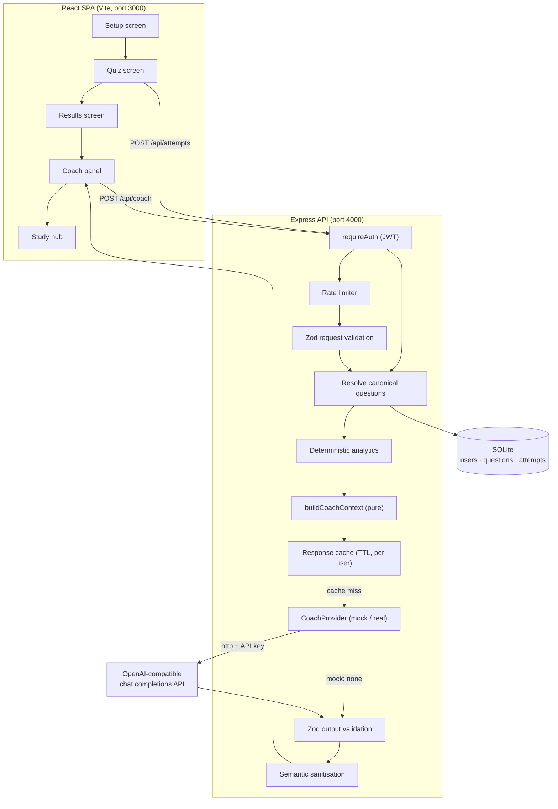

# DevCode — Interview Prep with an AI Coach

**A full-stack developer-interview prep hub: 15 study topics, a 97-question timed assessment engine, and an AI coach that turns a finished quiz into explanations, a study plan, and targeted practice questions.**

DevCode is a React + TypeScript single-page app backed by an Express + TypeScript API with a SQLite-compatible database (Drizzle ORM over the libSQL client — a local file in development, a remote Turso server in production). Accounts, persisted quiz attempts, deterministic learning analytics, and the AI coach all live in the API; the SPA renders them.

> **Status.** The core product is implemented and covered by automated tests (38 frontend test files / 238 tests, 17 API test files / 186 tests). The AI coach ships in two interchangeable forms: a deterministic **mock provider** (default, no API key, no cost) and an **OpenAI-compatible provider** (configured by environment variable). The deployment configuration for Vercel, the CI pipeline and the database tooling are in place, but **nothing has been deployed** — see [Deployment](#deployment), [DEPLOYMENT.md](DEPLOYMENT.md) and [Limitations](#limitations). There is no license file yet and no institutional adoption.

---

## Table of contents

- [Why DevCode exists](#why-devcode-exists)
- [Who it is for](#who-it-is-for)
- [What it does](#what-it-does)
- [Feature status](#feature-status)
- [How it works](#how-it-works)
- [AI usage disclosure](#ai-usage-disclosure)
- [Security](#security)
- [Tech stack](#tech-stack)
- [Getting started](#getting-started)
- [Deployment](#deployment)
- [Environment configuration](#environment-configuration)
- [Using the app](#using-the-app)
- [Tests and quality checks](#tests-and-quality-checks)
- [Limitations](#limitations)
- [Future scope / roadmap](#future-scope--roadmap)
- [Contributing](#contributing)
- [License](#license)
- [Acknowledgements](#acknowledgements)

---

## Why DevCode exists

A quiz score tells you _that_ you got 8 of 20 wrong. It does not tell you _why_, it does not group your mistakes by the concept that actually caused them, and it does not tell you what to read next. Most prep tools stop at the score.

DevCode is built around the gap between "you missed things" and "here is what to study, in what order, and what to practise on it":

- **The mistake, not just the mark.** The Results screen separates _wrong_, _correct_ and _skipped_, and the review shows the canonical explanation for every question.
- **Weak areas, computed not guessed.** Misses are bucketed into focus areas and ranked by severity using deterministic server-side counting — never by the model.
- **A path from result to revision.** Each weak area is mapped to an existing Study topic, so a recommendation is a link into content that already exists in the app rather than invented text.
- **Practice that follows the gap.** The coach can propose extra questions on the topics you actually missed, and they are run through the _same_ quiz engine as the rest of the app.

The AI is used for the part that benefits from language: explaining _why_ an answer was wrong and phrasing practice questions. Everything factual — correctness, accuracy, weak-topic ranking, which topics exist — is computed by the server and is verifiable in code.

## Who it is for

**Primary**

- **Learners who want to understand mistakes, not just scores.** Someone who finishes a set and asks "what exactly did I get wrong, and what concept does it belong to?"
- **Self-directed interview candidates** who need a revision order rather than a flat topic list, and want to practise on their weak areas immediately.

**Secondary**

- **Educators and reviewers** assessing how an AI-assisted learning-support workflow can be built with the model constrained to trusted, retrievable source material.
- **Developers** reading the coach pipeline as a worked example: a provider abstraction, deterministic context assembly, schema-validated output, semantic sanitisation, caching, cost control, and an evaluation harness.

### What this project is / is not

| It is                                                                             | It is not                                                                               |
| --------------------------------------------------------------------------------- | --------------------------------------------------------------------------------------- |
| A self-directed practice and study tool                                           | A replacement for a teacher, mentor, or official course material                        |
| A place to see _why_ an answer was wrong, grounded in the app's own question bank | A source of authoritative educational content — model-written explanations can be wrong |
| An example of constraining an LLM to a trusted corpus                             | An autonomous tutor: every step is user-triggered                                       |
| A single-developer project with automated tests, CI and a documented architecture         | A production service with SLAs, uptime guarantees or automated backups           |

---

## What it does

The verified end-to-end journey:

1. **Pick a run.** Choose one or more of the 10 tracks (DSA, system design, OOP, SQL, web, OS, Python, C++, Java, JavaScript), a difficulty (Beginner / Intermediate / Advanced / Mixed), a length (5 / 10 / 15 / 20, or fewer if a track is small), and timed or untimed mode (90 s per question by default).
2. **Answer.** One question at a time, options shuffled per session, keyboard shortcuts (`1`–`4` / `A`–`D`, arrows to navigate, `F` to flag), a confirmation step if questions are unanswered, and an automatic submit when the clock runs out.
3. **Persist the attempt.** On submit the client posts the attempt to `POST /api/attempts`. The **server** resolves correctness from its own copy of the question bank — the client's answer key is never trusted — and stores one row per question.
4. **Review the results.** Score, per-track breakdown, focus areas drawn from the missed questions, and a full per-question review with the canonical explanation.
5. **Ask the coach.** "Coach me on my misses" posts the attempt to `POST /api/coach`. The server rebuilds a context from the stored attempt, computes the learner's accuracy trends from their own history, and asks the configured provider for an answer.
6. **Get coaching.** The response contains **explanations** (why each answer was wrong, the concept, and the canonical reference), a **study plan** (prioritised links to existing Study topics), and **practice questions** (new multiple-choice items on the weak topics, marked `aiGenerated`).
7. **Follow the plan.** Each study-plan entry opens the real Study topic. Leaving Study returns you to the _same_ Results screen with the same coaching session intact — the result, the explanations, the recommendations and the expanded sections are all restored.
8. **Practise.** The generated questions are validated against the existing `Question` contract and then run through the _same_ quiz engine as bank questions — there is no second quiz engine.

Every step above is implemented and covered by tests. Two things are deliberately **not** implemented: a code-writing exercise mode (the daily-challenge page is a prompt with a code skeleton, not a judge), and any kind of teacher-facing dashboard.

---

## Feature status

| Feature                                                                                        | Status                                             | Evidence                                                                                              |
| ---------------------------------------------------------------------------------------------- | -------------------------------------------------- | ----------------------------------------------------------------------------------------------------- |
| Study hub: 15 topics, search, category/tag filters, deep links, bookmarks + mastery            | **Implemented**                                    | `src/pages/Study/`, `src/data/topicBank/`, `src/pages/Study/StudyPage.test.tsx`                       |
| Practice engine: track/difficulty/count selection, shuffle + index remap, timer, flags, review | **Implemented**                                    | `src/pages/Practice/usePracticeSession.ts`, `computeResult.ts`, `src/utils/shuffle.ts`                |
| Question bank: 97 questions, 10 tracks, 3 difficulties, quality guard                          | **Implemented**                                    | `src/data/questionBank/`, `src/data/questionBank/bankQuality.test.ts`                                 |
| Accounts: register, login, current user, JWT bearer, bcrypt hashing                            | **Implemented**                                    | `server/src/routes/auth.ts`, `server/src/auth/`                                                       |
| Server-persisted quiz attempts with canonical correctness                                      | **Implemented**                                    | `server/src/routes/attempts.ts`, `server/src/db/schema.ts`                                            |
| AI coach: explanations, study plan, practice questions                                         | **Implemented**                                    | `server/src/coach/`, `server/src/routes/coach.ts`                                                     |
| Mock AI provider (no key, no cost, deterministic)                                              | **Implemented**                                    | `server/src/coach/mockProvider.ts`                                                                    |
| OpenAI-compatible provider behind `COACH_PROVIDER=openai`                                      | **Implemented, not verified against a live model** | `server/src/coach/realProvider.ts` (exercised only through mocks in tests)                            |
| Deterministic learning analytics (accuracy, weekly trend, weak topics)                         | **Implemented**                                    | `server/src/coach/analytics.ts`, `server/test/coach.analytics.test.ts`                                |
| Coach response caching, in-flight de-duplication, cost budget, rate limiting                   | **Implemented**                                    | `server/src/coach/cache.ts`, `server/src/coach/realProvider.ts`, `server/src/middleware/rateLimit.ts` |
| Coach evaluation harness (10 cases, ≥ 9/10 bar)                                                | **Implemented**                                    | `server/src/coach/evaluation.ts`, `server/test/coach.evaluation.test.ts`                              |
| Results → Study state preservation                                                             | **Implemented**                                    | `src/pages/Practice/resultsSnapshot.ts`, `CoachStudyNavigation.test.tsx`                              |
| Code-exercise judging / submissions                                                            | **Not implemented**                                | `submissions` table exists in the schema but no route reads or writes it                              |
| Teacher / educator workflows                                                                   | **Not implemented**                                | —                                                                                                     |
| Deployment configuration for Vercel (two projects, environment variables, health endpoints) | **Documented, not deployed**                       | `DEPLOYMENT.md`, `vercel.json`, `server/vercel.json`                                          |
| CI pipeline (typecheck, lint, tests, build, migration check, audit, secret scan)            | **Implemented**                                    | `.github/workflows/ci.yml`                                                                    |
| Automated backups                                                                             | **Not implemented**                                | Backups depend on the database provider (Turso point-in-time restore)                        |
| Container image for a self-hosted deployment                                                  | **Implemented, not verified**                      | `Dockerfile`, `docker-compose.yml`                                                            |
| Mobile app / offline mode                                                                      | **Not implemented**                                | —                                                                                                     |

---

## How it works

### Architecture



### The request path

**Attempt persistence** — `POST /api/attempts`

1. `requireAuth` rejects the request without a valid bearer token.
2. The body is validated with `CoachAttemptsSchema` (Zod): an attempt id, 1–50 questions, no duplicate ids.
3. Each `questionId` is looked up in the `questions` table. A missing question fails the whole request with `404`.
4. `isCorrect` is computed as `selectedIndex === questions.correct_index`. **The client cannot influence correctness.**
5. All rows are inserted in one transaction, so a partial attempt is never persisted. A duplicate `(user, quiz, question)` is rejected with `409`.

**Coaching** — `POST /api/coach`

1. `requireAuth` → 401 without a token.
2. Rate limiter (default 10 requests / 60 s per user) → 429.
3. `CoachRequestSchema` (Zod) validates the attempt id and question list → 400.
4. Each question is resolved from the `questions` table; the canonical `correct_index` and `explanation` replace anything the client claimed → 404 for unknown ids.
5. The learner's own attempt history is read, and **deterministic** analytics are computed: accuracy per focus area, UTC weekly buckets (weeks start Monday), previous-period comparison, weak topics.
6. `buildCoachContext()` — a pure function — turns the attempt into the coaching context: misses, skips, trusted explanations, focus areas, resolved Study topic ids, and ranked weak topics. It never calls a model.
7. The cache is consulted with a key that includes the user id, a hash of the normalised attempt, the context version, the prompt version, and the model name. On a miss, the provider runs (identical in-flight requests share one call).
8. The provider's answer is parsed and validated against `CoachResponseSchema` (Zod): explanations, study plan entries, and practice questions with 2–6 distinct options and an in-range `correctIndex`.
9. The answer is **semantically sanitised**: explanations that do not reference a question in this attempt are dropped, study-plan entries that do not point at a real Study topic are dropped, duplicates are collapsed, and `aiGenerated` is stamped by the server.
10. The response is returned and cached.

### How correctness is established

Correctness never comes from the browser. The server holds its own copy of every question (`questions.slug`, `correct_index`, `explanation`), seeded from the frontend bank by `npm run db:seed`. The client sends only _which option the learner picked_; the server compares that against `correct_index`. The AI receives the already-resolved answer, not the client's claim.

### How context is assembled

`buildCoachContext(attempt)` (`server/src/coach/contextBuilder.ts`) is a pure, I/O-free function:

- a question is a **miss** when the learner answered and the answer differs from the canonical one;
- a question is **skipped** when the learner answered nothing;
- weak topics are bucketed by focus area, ranked by miss count, and assigned a severity and a priority;
- duplicate question ids are de-duplicated deterministically;
- all-correct, all-skipped, empty and missing-focus-area attempts are all valid inputs and never throw.

The context carries only what the model needs: per-miss question id, focus area, category, resolved Study topic id, the learner's selected index, the canonical correct index and the canonical explanation — plus aggregate analytics. **No email address, display name, or user id is included.**

### How practice questions are produced and validated

This is a **hybrid flow**, and the distinction matters:

- The _source_ of practice questions is the **model**, not the bank. The provider is asked for new multiple-choice items targeting the weak topics.
- The _contract_ is the existing bank contract. Every generated item must satisfy the same rules as a bank question: a supported category, a supported difficulty, 2–6 distinct options, and a `correctIndex` that points at one of them (`server/src/coach/contracts.ts`).
- The _client_ validates again before anything can enter the quiz engine (`src/utils/coachQuestion.ts`): items that fail are dropped, not repaired.
- Valid items are then shuffled and index-remapped by the **existing** session engine (`toSessionQuestion`) and rendered by the **existing** quiz screen. The generated items carry an `aiGenerated` badge.
- With the mock provider (the default), the generated items are **deterministically constructed from the attempt context**, not sampled from the bank — so the mock exercises the same pipeline without a model.

### Errors, timeouts and edge cases

| Situation                                               | Behaviour                                                                |
| ------------------------------------------------------- | ------------------------------------------------------------------------ |
| No token / invalid token                                | `401`                                                                    |
| Malformed body                                          | `400` with field-level details                                           |
| Unknown question id                                     | `404`                                                                    |
| Duplicate attempt submission                            | `409`                                                                    |
| Rate limit exceeded                                     | `429`                                                                    |
| Provider returned an unusable payload                   | `502`                                                                    |
| Provider not configured / daily budget exhausted        | `503`                                                                    |
| Provider request slower than `COACH_REQUEST_TIMEOUT_MS` | request aborted, `502`                                                   |
| Unexpected server error                                 | `500` with a generic message — internal details are logged, not returned |
| All answers correct                                     | `200` with empty arrays — the coach has nothing to explain               |
| All questions skipped                                   | `200` with empty arrays                                                  |
| Empty attempt                                           | the request schema rejects it (`400`)                                    |

Schema-invalid model output and transient provider failures are retried up to twice (three attempts in total). The retry count is a constructor argument on `RealCoachProvider`, not an environment variable. The daily token budget (`COACH_DAILY_TOKEN_BUDGET`) stops the provider once the estimated cost for the process-day is exceeded.

### API endpoints

| Method | Path                 | Auth   | Purpose                                              |
| ------ | -------------------- | ------ | ---------------------------------------------------- |
| `GET`  | `/api/live`          | —      | Liveness: the process is up (no dependency checks)   |
| `GET`  | `/api/health`        | —      | Readiness: the process is up **and** the database answers |
| `POST` | `/api/auth/register` | —      | Create an account → `{ token, user }`                |
| `POST` | `/api/auth/login`    | —      | Email + password → `{ token, user }`                 |
| `GET`  | `/api/auth/me`       | Bearer | The current user                                     |
| `POST` | `/api/attempts`      | Bearer | Persist a finished attempt                           |
| `POST` | `/api/coach`         | Bearer | Generate coaching for an attempt                     |

### Key files

```
src/
  pages/Practice/          setup, quiz, results, coach panel, session hook
  pages/Practice/resultsSnapshot.ts   persisted result + coaching session
  pages/Study/             filters, topic cards, topic detail dialog
  pages/Auth/              login and signup forms
  components/              Button, Navbar, Toast, ProtectedRoute, NavigationGuard…
  data/questionBank/       97 questions across 10 tracks
  data/topicBank/          15 study topics across 4 categories
  services/api.ts          typed API client (the only place the SPA talks HTTP)
  utils/coachQuestion.ts   validation gate for generated practice questions
  styles/tokens.css        colours, spacing, radii — edit here, not elsewhere

server/
  src/coach/               contracts, context builder, providers, cache, prompt,
                           analytics, topic map, sanitiser, evaluation harness
  src/routes/              auth, attempts, coach
  src/db/schema.ts         users, questions, submissions, attempts, progress
  src/db/seed.ts           mirrors the frontend bank into the questions table
  drizzle/                 committed SQL migrations (0000–0002)
  scripts/smoke-coach.ts   end-to-end check of the coach pipeline
```

`AUDIT.md` is a **dated, historical** engineering audit (2026-10-18, revision `9986d44`). Its findings were largely remediated by later commits, and it predates the AI coach work entirely — read it as history, not as a description of the current code.

---

## AI usage disclosure

This section separates two very different things: AI that helped _build_ the website, and AI that the _running website_ calls.

### A. AI used during development

**The repository does not currently contain a verified record of the specific AI tools, models, or extent of assistance used during development.** The commit history (61 commits, a single author) does not mention a coding assistant, and no development-notes file exists. Rather than infer usage from code style, this section is left for the maintainer to complete accurately.

<!-- MAINTAINER: replace this block before publishing -->

> _To be completed by the maintainer: which assistant(s) were used (name and version, if known), which parts of the work they assisted with (for example: architecture brainstorming, code assistance, debugging, test generation, documentation), and the extent of human review and responsibility._

### B. AI used at runtime

This is fully evidenced in the source.

**Provider and model configuration.** The coach talks to a provider through a one-method interface, `CoachProvider` (`server/src/coach/provider.ts`):

```ts
export interface CoachProvider {
  readonly name: string;
  generate(ctx: CoachContext): Promise<unknown>;
}
```

Two implementations exist:

| Provider            | Selected by                     | Behaviour                                                                                                                                                                                                                                                                                                                                       |
| ------------------- | ------------------------------- | ----------------------------------------------------------------------------------------------------------------------------------------------------------------------------------------------------------------------------------------------------------------------------------------------------------------------------------------------- |
| `MockCoachProvider` | `COACH_PROVIDER=mock` (default) | No network, no API key, no cost. Builds a deterministic answer from the attempt context and repeats byte-for-byte for the same context.                                                                                                                                                                                                         |
| `RealCoachProvider` | `COACH_PROVIDER=openai`         | `POST {COACH_BASE_URL}/chat/completions` with `response_format: { type: "json_object" }`, `model: COACH_MODEL`, `max_tokens: COACH_MAX_OUTPUT_TOKENS` and a bearer token. The defaults are `COACH_BASE_URL=https://api.openai.com/v1` and `COACH_MODEL=gpt-4o-mini`, so any OpenAI-compatible endpoint can be substituted without code changes. |

The provider is chosen per request by `createCoachProvider()` (`server/src/coach/providerFactory.ts`); nothing else in the application knows which one is active. **The application runs fully with the mock provider and no API key.**

**What triggers an AI request.** Exactly one user action: pressing "Coach me on my misses" on the Results screen. The coach endpoint is never called on page load, on navigation, or in the background. A repeated identical request for the same attempt is served from the server cache, so no second paid call is made.

**What is sent to the provider.** The context is assembled server-side and serialised as JSON:

- `attemptId` — an opaque `attempt-<timestamp>` string;
- `misses` — per missed question: question id, focus area, category, resolved Study topic id, the learner's selected option index, the canonical correct option index, and the canonical explanation text;
- `skipped` — the same fields for questions the learner skipped;
- `weakTopics` — ranked focus areas with their Study topic ids, miss counts, severity and priority;
- `analytics` — the learner's own accuracy per focus area, weekly window, previous-period trend and weakest topics.

**Not sent:** email address, display name, user id, password, JWT, or any free-text field the learner typed. The payload is assembled from the server's own records. The prompt (`server/src/coach/prompt.ts`) frames the whole payload as _untrusted data_ and instructs the model to treat instruction-like text inside it as content, not as a command.

**What comes back.** A JSON object with three arrays — `explanations` (question id, why it was wrong, the concept, a reference explanation), `studyPlan` (Study topic id, reason, priority) and `practiceQuestions` (full question objects with `aiGenerated: true`).

**Deterministic logic vs. model output.**

| Deterministic (server, verifiable)         | Model-generated (unverified)                            |
| ------------------------------------------ | ------------------------------------------------------- |
| Correct / incorrect / skipped per question | The prose of "why this was wrong"                       |
| Accuracy, weekly trend, previous period    | The phrasing of the concept label                       |
| Weak-topic bucketing, severity and ranking | The wording of the study-plan reason                    |
| Which Study topic a miss maps to           | The generated practice questions and their explanations |
| Schema validation of the whole answer      | —                                                       |

**Output validation.** Two layers. Schema validation (`CoachResponseSchema`, Zod) rejects a malformed answer outright — a malformed answer becomes a `502`, never a rendered result. Semantic sanitisation (`server/src/coach/sanitize.ts`) then drops explanations that do not reference a question in the attempt, drops study-plan entries whose topic id does not exist in the Study hub, collapses duplicates, and stamps `aiGenerated` server-side so the model cannot mislabel it. The browser validates the practice questions a third time before they can enter the quiz engine.

**Storage and retention.**

- The **attempt** is persisted in SQLite (`attempts` table), one row per question, linked to the user.
- The **coaching answer is not persisted server-side.** It lives in an in-process cache with a TTL (`COACH_CACHE_TTL_MS`, default 1 hour) and a size cap, and is mirrored into the browser's `sessionStorage` so the Results screen can be restored after a trip to the Study hub. Both are dropped when the process restarts or the tab closes.
- Provider usage is tracked in memory per process-day to enforce the cost budget. There is no usage database and no analytics pipeline.

**Keys and configuration.** `COACH_API_KEY` is read only by the server, from `server/.env`, and is never included in any response, log line, or bundle. The frontend only ever sees `VITE_*` variables, which Vite inlines into the client bundle — so no secret may ever be placed in a `VITE_*` variable. With `COACH_PROVIDER=mock` (the default) no key is needed at all.

> ⚠️ **Model output can be wrong.** Generated explanations and practice questions are written by a language model. They can be inaccurate, incomplete, or misleading even when they pass every schema and grounding check in this project, because those checks verify _shape and provenance_, not _truth_. Treat the coach as a study aid and verify anything important against your course notes or another trusted source.

---

## Security

The table below reflects what is **in the code today**, with the files or tests that back each claim. It is not a checklist of intentions.

| Area                        | Existing protection (evidence)                                                                                                                                               | Remaining limitation / loophole                                                                                                                                                                                                                                                                         | Risk                                | Recommended mitigation                                                                      |
| --------------------------- | ---------------------------------------------------------------------------------------------------------------------------------------------------------------------------- | ------------------------------------------------------------------------------------------------------------------------------------------------------------------------------------------------------------------------------------------------------------------------------------------------------- | ----------------------------------- | ------------------------------------------------------------------------------------------- |
| Password storage            | bcrypt with cost factor 10 (`server/src/auth/password.ts`); hashes only, never returned by any route                                                                         | No password policy beyond an 8-character minimum; no breach check                                                                                                                                                                                                                                       | Low                                 | Add a breached-password check; consider cost 12                                             |
| Token handling              | HS256 JWT signed with `JWT_SECRET` (min 16 chars, Zod-validated at boot); 7-day expiry; `Authorization: Bearer` header only                                                  | **No refresh tokens and no server-side revocation** — a stolen token stays valid until it expires; logout only deletes the local copy                                                                                                                                                                   | Medium                              | Add a token version or denylist; shorten the access-token lifetime and add refresh rotation |
| Authentication coverage     | `requireAuth` guards `/api/coach` and `/api/attempts`; `GET /api/auth/me` re-verifies the token; `/api/auth/login` and `/api/auth/register` are throttled per client IP (`AUTH_RATE_LIMIT_MAX`, 10 per 15 minutes by default) | Register still answers `409 Email already registered`, which allows account enumeration; the limiter is per process, so it does not hold across several function instances | Low                                 | Return a generic response on register, and move the limiter to a shared store                    |
| Route protection (frontend) | `ProtectedRoute` component exists and is unit-tested (`src/components/ProtectedRoute/`)                                                                                      | **It is not mounted on any route.** The UI does not require sign-in; the API does. An anonymous learner sees the coach error "Missing bearer token" instead of a sign-in prompt                                                                                                                         | Medium                              | Wrap the coach surface in `ProtectedRoute` and redirect to `/login` with a return path      |
| Authorisation / ownership   | Every query is scoped by the authenticated user id: attempts are written with `req.userId`, analytics read `attempts.userId = userId`, the cache key embeds the user id      | Coach answers are not stored, so there is nothing to IDOR; no cross-user read path was found                                                                                                                                                                                                            | Low                                 | Add a regression test asserting a user cannot observe another user's analytics              |
| Canonical correctness       | `isCorrect` is derived server-side from `questions.correct_index`; the client sends only the selected index (`server/src/routes/attempts.ts`)                                | The seeded question bank must stay in sync with the frontend bank (`npm run db:seed`); a stale seed would mark answers wrong                                                                                                                                                                            | Low                                 | Add a bank-parity check to CI                                                               |
| Input validation            | Zod schemas on every request body with length and count limits (`server/src/coach/contracts.ts`, `server/src/routes/schemas.ts`); 1 MB JSON body limit                       | The attempt limiter is per process, so it does not hold across several function instances                                                                                                                                                                                                             | Low                                 | Move the limiter to a shared store                                                          |
| SQL injection               | All queries go through the Drizzle query builder with bound parameters                                                                                                       | —                                                                                                                                                                                                                                                                                                       | Low                                 | —                                                                                           |
| AI prompt injection         | The system prompt labels the payload as untrusted data; the evaluation harness includes a prompt-injection case; injected text is passed through as data                     | The model can still be misled — the mitigation is _containment_ (schema + sanitisation + topic allow-list), not prevention                                                                                                                                                                              | Medium                              | Keep the sanitiser mandatory; extend the evaluation set with adversarial cases              |
| AI output validation        | Zod schema validation of the whole answer, semantic sanitisation of explanations and topic ids, and a third client-side check for practice questions                         | Sanitisation cannot verify that an explanation is _true_, only that it is grounded in the attempt                                                                                                                                                                                                       | Medium                              | Add a "source grounding" evaluation that scores explanations against the canonical text     |
| Practice-question safety    | Generated questions must satisfy the bank contract (category, difficulty, 2–6 distinct options, valid `correctIndex`); invalid ones are dropped, not repaired                | A valid-shaped question can still be pedagogically wrong                                                                                                                                                                                                                                                | Low                                 | Add evaluation scoring or human review of generated questions                               |
| Secrets                     | Server-only env parsing; `.env*` gitignored except the templates; no key is ever returned or logged; the SPA only reads `VITE_*`; a production boot rejects the `.env.example` placeholder and a local database | The placeholder still ships in the committed templates — harmless, but a careless deployer may keep it                                                                                                                                                                               | Low                                 | Keep the production boot check; rotate any secret that was ever committed        |
| Data sent to third parties  | The provider receives question ids, focus areas, option indices and canonical explanations — **no email, display name or user id**; analytics are the learner's own          | The provider is an external processor; there is no DPA, and the payload is not redacted beyond what is listed                                                                                                                                                                                           | Low                                 | Publish the exact payload in a privacy notice; allow a fully local provider                 |
| Logging                     | One structured JSON log line per request (method, path, status, duration, correlation id, user id) with **no headers, no cookies and no request bodies**; unexpected errors are logged with their name, message and stack only                          | The stack of an unexpected error can still contain internal paths or query text                                                                                                                                                                                                                       | Low                                 | Keep the redaction rules in `server/src/middleware/requestLogger.ts`                            |
| HTTP hardening              | `helmet()` enabled; `x-powered-by` disabled; CORS restricted to an allow-list from `CORS_ORIGIN`; JSON errors; optional Content-Security-Policy (`CSP_ENABLED`)                                                        | The CSP needs `'unsafe-inline'` for scripts and styles because `index.html` carries an inline theme bootstrap and the UI sets inline styles                                                                                                                                     | Medium                              | Self-host the fonts and move the theme bootstrap to a nonce-based inline script             |
| Transport security          | Plain HTTP in development only                                                                                                                                               | No TLS termination is configured — the deployment must provide it                                                                                                                                                                                                                                       | Medium                              | Terminate TLS at the reverse proxy and add HSTS                                             |
| Abuse / cost control        | Per-user rate limit on the coach (10 / 60 s), request timeout, bounded retries, per-process daily token budget, response cache, in-flight de-duplication                     | The rate limiter and the budget are **in-process** — a multi-instance deployment multiplies the limits; the budget uses a fixed estimate, not provider billing                                                                                                                                          | Medium                              | Move limits to a shared store; read actual usage back from the provider                     |
| Database                    | SQLite dialect (local file or a remote libSQL/Turso server) with WAL, foreign keys enforced, `ON DELETE CASCADE` from users; migrations are committed SQL                                                 | A local file has no encryption at rest; the remote database is protected only by its token                                                                                                                                                                                                            | Low                                 | Use the provider's access control and backups; encrypt the volume on a self-hosted host    |
| Dependencies                | Lockfiles committed for both packages; `npm audit --audit-level=high` is clean for runtime dependencies in both packages (`body-parser` was bumped to 2.4.0)          | Dev-only advisories remain (`vite` dev server, `esbuild` via `drizzle-kit`, `minimatch` via the ESLint toolchain)                                                                                                              | Low (dev-only)                      | Schedule dependency updates; keep the audit in CI                                       |
| XSS                         | Study topic rich text is sanitised to `<code>`, `<strong>`, `<em>` with all attributes stripped (`src/utils/sanitizeRichText.ts`); React escapes all other interpolated text | The sanitiser runs client-side at render time, so a bad payload would already be in the DOM                                                                                                                                                                                                             | Low                                 | Sanitise server-side too once topics are served by the API                                  |
| CSRF                        | The API is stateless and bearer-token authenticated — **no cookies are used**, so classic CSRF does not apply                                                                | A token readable by injected script is stealable (XSS is the real risk)                                                                                                                                                                                                                                 | Low                                 | Keep the token out of cookies; add a strict CSP                                             |
| Tests                       | 38 frontend test files (238 tests) and 17 API test files (186 tests) covering auth, authorisation, validation, the AI boundary, caching, rate limiting, deployment configuration and regression | No load testing and no third-party security review                                                                                                                                                                                                                                                   | Low                                 | Keep the CI gate green; add a load test before a public launch                           |

### Verified security advantages

- **Correctness is decided on the server.** The client cannot influence whether an answer was right.
- **Ownership is enforced at every read and write** of user-scoped data.
- **Model output is treated as untrusted input**: schema-validated, then semantically constrained to real Study topics and to the questions actually attempted.
- **Secrets stay server-side** and never enter the client bundle.
- **Costs are bounded** by a rate limit, a timeout, bounded retries, a daily budget and a cache.

### Not assessed

- No penetration test, load test or third-party security review exists.
- The real provider has never been exercised against a live model in this repository, so its error handling is only verified through mocks.
- Browser-level behaviours (XSS payload rendering, focus trapping, screen-reader output) were not verified with assistive technology.
- The `submissions` and `progress` tables exist in the schema but no route reads or writes them; they were not reviewed as an attack surface.

---

## Tech stack

| Layer    | Technology                                                                                  |
| -------- | ------------------------------------------------------------------------------------------- |
| Frontend | React 19, TypeScript 5.8, Vite 6, React Router 7, plain CSS design tokens (no UI framework) |
| Backend  | Node.js ≥ 20.19, Express 5, TypeScript 6, Zod 4, helmet, CORS allow-list                    |
| Database | SQLite dialect via the libSQL client (local file or remote Turso), queried with Drizzle ORM; SQL migrations committed |
| Auth     | JWT (HS256) bearer tokens, `bcryptjs` password hashing                                      |
| AI       | Provider interface with a deterministic mock and an OpenAI-compatible HTTP client           |
| Testing  | Vitest + Testing Library (jsdom) on the frontend, Vitest + Supertest on the API             |
| Tooling  | npm, strict TypeScript, ESLint (flat config), Prettier                                      |

## Getting started

### Prerequisites

- **Node.js ≥ 20.19** (the API declares this in `server/package.json`; development used Node 24.14)
- **npm** 10 or newer
- A C toolchain is **not** required — the libSQL client ships prebuilt binaries for common platforms.

### 1. API

```bash
cd server
npm install
cp .env.example .env          # the template works as-is; change JWT_SECRET
npm run db:migrate             # create/upgrade server/data/devcode.sqlite
npm run db:seed                # copy the 97-question bank into the questions table
npm run dev                    # tsx watch -> http://localhost:4000/api/health
```

### 2. Frontend

```bash
npm install
npm run dev                    # vite -> http://localhost:3000
```

The SPA calls the relative path `/api`, which the Vite dev server proxies to `http://localhost:4000`, so no extra configuration is needed. To point the SPA at another API host, set `VITE_API_BASE_URL` in a root `.env` (see `.env.example`); the origins the API accepts are listed in `server/.env` as `CORS_ORIGIN`.

> The login page reports **"Unable to connect. Please try again."** when the API is not running or is unreachable from the browser. Check `http://localhost:4000/api/health` first.

> **The AI coach needs an account.** The endpoint is authenticated, so sign up or log in before using it. With `COACH_PROVIDER=mock` (the default) no API key is needed and nothing is billed.

## Deployment

DevCode runs on **Vercel only**. The repository is a two-package monorepo and
becomes two Vercel projects:

| Vercel project | Root directory | Preset    | Serves                                    |
| -------------- | -------------- | --------- | ----------------------------------------- |
| `devcode-web`  | `/`            | Vite      | The SPA (static assets + deep-link fallback) |
| `devcode-api`  | `/server`      | Express   | The whole Express API as one Vercel Function |

The API is deployed with Vercel's zero-configuration Express support: the
application is exported as the default export of `server/src/index.ts`, and
every request of the project is routed to it. No container, no framework
change, no long-running process. The local listener (`server/src/local-server.ts`)
is a separate entry point, so nothing has to detect the platform at runtime.

Two consequences are worth knowing before the first deploy:

1. **The database must be external.** A Vercel Function has no writable,
   persistent filesystem, so the API talks to a libSQL/Turso server over HTTPS
   (`DATABASE_URL=libsql://…`). The SQL, the schema and the committed
   migrations are unchanged; only the connection is. Locally and in the tests
   the same code uses a plain SQLite file.
2. **Cross-origin is normal.** The web and the API have different hostnames, so
   the API allows the web origin through `CORS_ORIGIN`, the SPA is built with
   `VITE_API_BASE_URL=https://<api-host>/api`, and the Content-Security-Policy
   lists that origin in `CSP_CONNECT_SRC`.

### Health checks and uptime monitoring

The API exposes two unauthenticated endpoints:

| Endpoint      | Kind      | Checks the database? | Response                                        |
| ------------- | --------- | -------------------- | ----------------------------------------------- |
| `/api/live`   | Liveness  | **No**                | `200 {"status":"ok","uptimeSeconds":42}`        |
| `/api/health` | Readiness | Yes (`SELECT 1`)     | `200 {"status":"ok","uptimeSeconds":42,"db":"ok"}` |

**Point the uptime monitor at `/api/live`.** It answers as long as the process
can serve a request, touches no dependency, and reveals nothing about the
deployment — no environment values, no version, no hostnames, no credentials.
`/api/health` additionally proves that the database answers; it is meant for
manual checks and dashboards, not for a routine ping.

A 5-minute interval is the recommendation (it is also UptimeRobot's free-tier
interval). **Monitoring does not make the service always-on** — Vercel scales
functions to zero when they are idle, and Vercel, not the monitor, controls
availability. See [DEPLOYMENT.md](DEPLOYMENT.md) for the full procedure, the
exact environment variables, the UptimeRobot configuration and the official
Vercel policy references.

## Environment configuration

Templates: `.env.example` at the root (frontend) and `server/.env.example` (API). Copy each to `.env` beside it. Real `.env*` files are gitignored; only the templates are committed. The API validates every variable with Zod at boot and exits with a readable message if something is missing.

| Variable                     | Where    | Default                                       | Purpose                                                                                                                                                         |
| ---------------------------- | -------- | --------------------------------------------- | --------------------------------------------------------------------------------------------------------------------------------------------------------------- |
| `VITE_API_BASE_URL`          | frontend | `/api` (proxied)                              | Base URL the SPA calls. Leave unset in development so the Vite proxy is used. **Never put a secret here** — `VITE_*` values are inlined into the client bundle. |
| `NODE_ENV`                   | server   | `development`                                 | `development` / `test` / `production`                                                                                                                           |
| `PORT`                       | server   | `4000`                                        | API listen port                                                                                                                                                 |
| `CORS_ORIGIN`                | server   | `http://localhost:3000,http://127.0.0.1:3000` | Comma-separated allow-list of browser origins                                                                                                                   |
| `DATABASE_URL`               | server   | `./data/devcode.sqlite`                       | Database target. A local SQLite file (relative to `server/`), or `libsql://…` / `https://…` for a remote libSQL server — **required on Vercel**, where the filesystem is not persistent. |
| `DATABASE_AUTH_TOKEN`        | server   | —                                             | Access token for a remote libSQL server. Ignored for a local file.                                    |
| `JWT_SECRET`                 | server   | — (required)                                  | JWT signing secret, minimum 16 characters. **Change this.**                                                                                                     |
| `JWT_EXPIRES_IN`             | server   | `7d`                                          | Token lifetime                                                                                                                                                  |
| `COACH_PROVIDER`             | server   | `mock`                                        | `mock` (deterministic, offline) or `openai` (live provider)                                                                                                     |
| `COACH_MODEL`                | server   | `gpt-4o-mini`                                 | Model id sent to the provider                                                                                                                                   |
| `COACH_API_KEY`              | server   | —                                             | Provider API key. Optional with the mock provider; **server-side only**                                                                                         |
| `COACH_BASE_URL`             | server   | `https://api.openai.com/v1`                   | Provider base URL; any OpenAI-compatible endpoint works                                                                                                         |
| `COACH_MAX_OUTPUT_TOKENS`    | server   | `700`                                         | Upper bound on the completion length                                                                                                                            |
| `COACH_DAILY_TOKEN_BUDGET`   | server   | `50000`                                       | Per-process daily token allowance before the provider is disabled                                                                                               |
| `COACH_RATE_LIMIT_WINDOW_MS` | server   | `60000`                                       | Rate-limit window                                                                                                                                               |
| `COACH_RATE_LIMIT_MAX`       | server   | `10`                                          | Coach requests per window per user                                                                                                                              |
| `COACH_CACHE_TTL_MS`         | server   | `3600000`                                     | How long a coaching answer is reused for the same attempt                                                                                                       |
| `COACH_REQUEST_TIMEOUT_MS`   | server   | `30000`                                       | Timeout for a single provider request                                                                                                                           |
| `ALLOW_LOCAL_DATABASE`       | server   | `false`                                       | Allows a local database while `NODE_ENV=production`. A production boot **refuses** a local database by default, because a serverless function has no persistent filesystem. Only self-hosted/container deployments may set it. |
| `TRUST_PROXY`                | server   | `false`                                       | Number of proxy hops to trust for `X-Forwarded-*` (or `true`/`false`). Set it to `1` behind one proxy such as Vercel, otherwise the IP-keyed limits see the proxy address. |
| `LOG_LEVEL`                  | server   | `info`                                        | `silent` / `error` / `warn` / `info` / `debug`. One structured JSON log line per request, with a correlation id and no request bodies, headers or credentials. |
| `STATIC_DIR`                 | server   | — (unset)                                     | Optional path to a built SPA. When set, the API also serves the web client (single-origin deployment). **Leave unset on Vercel** — Vercel ignores `express.static()` inside a function. |
| `CSP_ENABLED`                | server   | `false`                                       | Enables the Content-Security-Policy header.                                                       |
| `CSP_CONNECT_SRC`            | server   | —                                             | Extra origins allowed by `connect-src` (comma separated) — needed when the SPA and the API are on different origins. |
| `AUTH_RATE_LIMIT_MAX`        | server   | `10`                                          | Sign-in attempts per window per client IP.                                                        |
| `AUTH_RATE_LIMIT_WINDOW_MS`  | server   | `900000`                                      | Sign-in rate-limit window (15 minutes).                                                           |
| `ATTEMPT_RATE_LIMIT_MAX`     | server   | `60`                                          | Attempt submissions per window per user.                                                           |
| `ATTEMPT_RATE_LIMIT_WINDOW_MS` | server | `60000`                                       | Attempt rate-limit window.                                                                        |
| `SEED_ALLOW_PRODUCTION`      | server   | `false`                                       | Escape hatch that lets `npm run db:seed` write to a production database. The seed is idempotent, but the guard makes it explicit — it triggers whenever the target is a **remote** libSQL server or `NODE_ENV=production`. |

The database tools (`npm run db:migrate`, `npm run db:seed`, `npm run db:backup`)
read `DATABASE_URL` and `DATABASE_AUTH_TOKEN` straight from the environment, so
an operator can migrate or seed a remote database without also supplying a
server secret such as `JWT_SECRET`.

### Using a real provider

```bash
# server/.env
COACH_PROVIDER=openai
COACH_API_KEY=<your key>
COACH_MODEL=gpt-4o-mini
```

Restart the API. Any OpenAI-compatible endpoint works by changing `COACH_BASE_URL`. Leave `COACH_PROVIDER=mock` to develop entirely offline and for free.

## Using the app

1. Open <http://localhost:3000>.
2. **Create an account** (the coach requires one).
3. Go to **Practice**, pick tracks, difficulty and length, and start the quiz.
4. Answer, then submit. The attempt is saved to your account and the Results screen shows your score, per-track breakdown, focus areas and a full review.
5. Press **Coach me on my misses**. The coach explains each miss, proposes a prioritised study plan, and may suggest extra practice questions.
6. Press **Open in Study hub** on a recommendation to open that topic. Closing it (or pressing Back) returns you to the same Results screen with the coaching session intact.
7. Press **Practice these N questions** to run the generated questions through the normal quiz engine.

### Browser storage

The app keeps a small amount of state in the browser. Nothing here is sensitive, and none of it is synced between devices.

| Key                        | Store          | Contents                                                   |
| -------------------------- | -------------- | ---------------------------------------------------------- |
| `devcode_theme`            | localStorage   | `'light'` or `'dark'`                                      |
| `devcode_study_mastered`   | localStorage   | JSON array of mastered topic ids                           |
| `devcode_study_bookmarks`  | localStorage   | JSON array of bookmarked topic ids                         |
| `devcode_quiz_history`     | localStorage   | JSON array of recent attempts (newest first, capped at 20) |
| `devcode_auth_token`       | localStorage   | The JWT bearer token                                       |
| `devcode_practice_draft`   | sessionStorage | An interrupted quiz, so it can be resumed                  |
| `devcode_practice_results` | sessionStorage | The finished attempt, so Results can be restored           |
| `devcode_practice_coach`   | sessionStorage | The coaching answer for that attempt                       |
| `devcode_practice_return`  | sessionStorage | Marks that the user left Results for the Study hub         |

### Behaviour notes

- **Practice** — multi-track selection, four difficulty modes, 5–20 questions, a 90 s-per-question countdown (or untimed), a warning before submitting with unanswered questions, and a review of every question. An interrupted quiz can be resumed or discarded on the next visit.
- **Quiz shortcuts** — `1`–`4` or `A`–`D` to answer, arrows to navigate, `F` to flag. The timer is wall-clock based, so it does not drift when the tab is in the background.
- **Study hub** — search, category and tag filters, `?category=` deep links, bookmark and mastery state, and a topic detail dialog with sanitised rich text. `?topic=<id>` opens a topic directly, which is how a coach recommendation links into it.
- **Accessibility** — keyboard-operable controls, visible focus rings, a focus trap and focus restore in dialogs, live regions for the timer and the coach status, and `prefers-reduced-motion` support.

## Tests and quality checks

All commands were run on Node 24.14 in this repository.

| Command               | Location  | Result                                                                    |
| --------------------- | --------- | ------------------------------------------------------------------------- |
| `npm test`            | root      | 38 files, **238 passed**, 1 expected fail                                 |
| `npm run typecheck`   | root      | clean (`tsc --noEmit`)                                                    |
| `npm run lint`        | root      | 0 errors, 1 pre-existing `react-refresh` warning                          |
| `npm run build`       | root      | success (`tsc --noEmit && vite build`)                                    |
| `npm test`            | `server/` | 17 files, **186 passed**                                                  |
| `npm run typecheck`   | `server/` | clean                                                                     |
| `npm run lint`        | `server/` | clean                                                                     |
| `npm run build`       | `server/` | success                                                                   |
| `npm run coach:smoke` | `server/` | end-to-end check of the whole coach pipeline against a throwaway database |

There is no root-level `audit` script; run `npm audit` in each package.

A GitHub Actions workflow (`.github/workflows/ci.yml`) runs the same gate on
every pull request: typecheck, lint, tests and the production build for both
packages, a migration check against a disposable database, `npm audit
--audit-level=high`, and a secret scan (`npm run scan:secrets`). It needs no
production secret and deploys nothing.

Test layout:

- **Frontend** (`src/**/*.test.tsx`) — component and hook tests, including the full quiz → coach → study → back journey.
- **API** (`server/test/*.test.ts`) — Supertest integration tests for auth, attempts and the coach endpoint, plus unit tests for the context builder, contracts, analytics, cache keys, topic mapping, sanitisation and the prompt.
- **Deployment tests** (`server/test/deployment.test.ts`, `server/test/liveness.test.ts`) — production environment validation, the rate limiter, the CORS allow-list, the health endpoints, the Vercel entry point and the migration sequence.
- **Evaluation harness** (`server/src/coach/evaluation.ts`) — 10 representative attempts run through the mock provider and scored for schema validity, grounding, topic mapping, practice-question validity, injection resistance and determinism; the suite enforces a ≥ 9/10 bar.

## Limitations

- **The AI coach needs a real account.** The endpoint is authenticated, but no route in the SPA is wrapped in the existing `ProtectedRoute`, so an anonymous visitor sees an API error instead of a sign-in prompt.
- **The real provider has not been run against a live model here.** It is implemented and unit-tested through mocks; treat its first live run as untested.
- **Coach answers are not persisted server-side.** They live in an in-process cache and in the browser's `sessionStorage`.
- **The rate limiter and the cost budget are per process**, so they do not hold across multiple instances.
- **There is no code-exercise judging.** The daily challenge shows a prompt and a code skeleton; nothing is compiled or evaluated. The `submissions` table is unused.
- **The Study hub is read-only on the server.** Mastery and bookmarks are stored in `localStorage` on the device; the `progress` table is unused.
- **The CI pipeline exists, but nothing is deployed by the repository.** The Vercel configuration is documented in [DEPLOYMENT.md](DEPLOYMENT.md); the owner creates the projects, provisions the database and deploys. Automated backups are not implemented — backups depend on the database provider (Turso point-in-time restore).
- **The question bank is hand-written** (97 questions). Coverage is broad but shallow relative to a full interview curriculum, and the "High frequency" tag reflects the author's judgement rather than market data.
- **No license, no contributing guide, no changelog.** See [Contributing](#contributing) and [License](#license).
- **Light-theme contrast was improved but not re-certified**; no formal WCAG audit or assistive-technology testing has been carried out.

## Future scope / roadmap

None of the following is committed work. The items are suggestions for whoever picks the project up, labelled by how they were arrived at.

**Potential — close the gaps that already exist in the code**

- Mount `ProtectedRoute` around the coach surface and redirect to `/login` with a return path.
- Add token revocation or a shorter access-token lifetime.
- Move the rate limiter, the coach cache and the daily token budget to a shared store, so they hold across several function instances.

**Potential — strengthen the AI guarantees**

- Score explanations for _grounding_ in the canonical explanation text, not just for schema validity and reference presence.
- Expand the evaluation dataset with adversarial injections and multi-topic attempts, and wire the harness into CI so a prompt change cannot silently regress quality.
- Track provider usage against real billing instead of a fixed token estimate.

**Potential — learning experience**

- Persist the coaching answer server-side so it survives a device change and can be reviewed later.
- Move Study progress (mastery, bookmarks) from `localStorage` to the API, which would use the existing `progress` table.
- Per-learner revision scheduling that uses the persisted weekly trend to decide what to re-surface.
- A code-exercise path that actually compiles and evaluates submissions, using the unused `submissions` table.

**Potential — product and operations**

- Educator-facing views over cohort analytics (this needs the server-side progress data first).
- Accessibility: a formal contrast audit and assistive-technology review of the quiz timer and results.
- Deployment hardening: TLS, CSP with nonces, self-hosted fonts, a shared rate-limit store, structured logs and error tracking.

**Under consideration** — a data-retention and account-deletion workflow, and multilingual explanations.

## Contributing

There is no `CONTRIBUTING.md` yet; this section is the working agreement.

1. **One focused change per commit.** The history follows `feat:` / `fix:` / `test:` / `chore:` / `docs:` prefixes and keeps each step independently buildable.
2. **Run the full gate before opening a pull request** — `npm run typecheck && npm run lint && npm test` at the root and the same three in `server/`, plus `npm run build` in both.
3. **New behaviour needs a test.** The suite currently covers the quiz engine, auth, the attempts API, the coach boundary and the results → study navigation.
4. **Keep the strict TypeScript flags on.** `noUncheckedIndexedAccess`, `exactOptionalPropertyTypes` and friends are enabled; do not loosen them to make a change compile.
5. **Do not weaken the coach's guarantees.** The context builder stays pure and deterministic; correctness stays server-side; model output stays schema-validated and semantically sanitised. Do not let a model decide what is "correct".
6. **Adding a question** — add it to the right file in `src/data/questionBank/`, keep `correctIndex: 0` (the engine shuffles and remaps), and re-run `npm run db:seed` so the server copy stays in sync. `src/data/questionBank/bankQuality.test.ts` enforces four options, a valid index, no duplicates and a bounded answer-length skew.
7. **Adding a study topic** — add it to `src/data/topicBank/` (categories: `dsa`, `must_know`, `language`, `db_sys`). Rich text may use only `<code>`, `<strong>`, `<em>`; it is sanitised at render time. If it should be reachable from a coach recommendation, add its id to `STUDY_TOPIC_IDS` in `server/src/coach/topicMap.ts`.
8. **Styling** — edit `src/styles/tokens.css` for colour and spacing, `src/styles/typography.css` for fonts and sizes. Do not hardcode colours in components.

## License

**No license file is currently provided.** Without one, the default copyright rules apply and the repository is not granted permission for reuse. If you want to use, modify or redistribute this project, ask the maintainer to add a license — or add one yourself and open a pull request.

## Acknowledgements

- The question bank and study topics were written by hand for this project.
- The AI coach runs on an OpenAI-compatible chat-completions API by default; the provider is swappable, and the deterministic mock provider means the whole application can be developed and tested with no external service.
- The project was developed as a single-author effort; see the [AI usage disclosure](#ai-usage-disclosure) for what is and is not documented about the tooling used.
